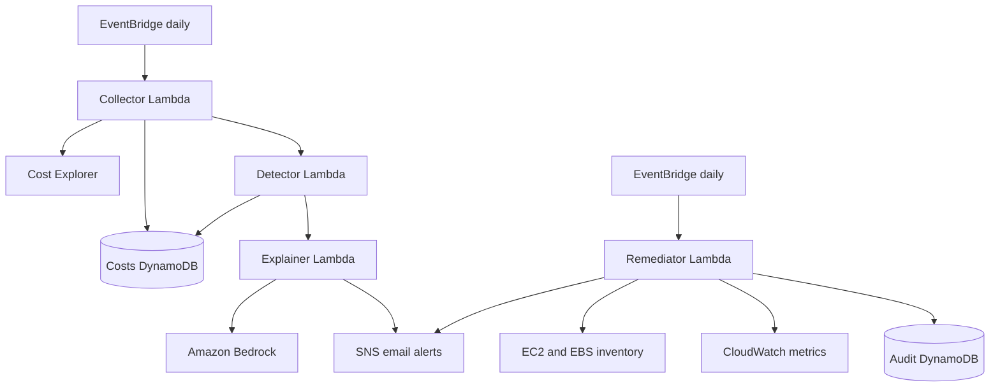

# AI Cost Guardian

An AWS FinOps portfolio project that collects daily spend by service, flags unusual increases, asks Amazon Bedrock for likely causes, and reports potentially idle EC2, EBS, and Elastic IP resources. It is designed to start in **report-only mode**.

> This repository is a learning project. Review the Terraform plan and AWS permissions before deploying it to an account with workloads. Do not enable live remediation in a production account.

## What it does

1. A daily collector reads the previous day's service costs from Cost Explorer and stores them in DynamoDB.
2. A detector compares those costs with up to seven prior days. It requires at least three observations and filters small dollar changes.
3. An explainer asks Bedrock for likely causes and sends a combined summary through SNS email. If Bedrock is unavailable, the deterministic cost summary is still sent.
4. A scheduled remediator reports low-CPU running instances, unattached EBS volumes, and unassociated Elastic IPs. It writes its findings to an audit table. The default is dry-run; stopping instances and deleting/releasing resources require configuration switches.

## Architecture



## Repository layout

- `src/` — Lambda handlers and pure detection/safety logic
- `terraform/` — AWS infrastructure and schedules
- `tests/` — unit tests for pure business logic; no AWS account required
- `scripts/backfill.sh` — invokes the collector for historical dates
- `.github/workflows/ci.yml` — Python lint/unit checks and Terraform format/validation

## Deploying a development copy

Prerequisites: Python 3.12, Terraform 1.5+, AWS CLI credentials for a dedicated development account, and Bedrock model access in the selected Bedrock region. Set an AWS Budget and billing alert in the account before creating resources. AWS service prices and model availability vary by region and can change; check the AWS console before deployment.

```bash
python -m venv .venv
source .venv/bin/activate
pip install -r requirements-dev.txt
pytest

cp terraform/terraform.tfvars.example terraform/terraform.tfvars
# Edit terraform.tfvars with your alert email and model settings.
terraform -chdir=terraform init
terraform -chdir=terraform fmt -recursive
terraform -chdir=terraform plan
terraform -chdir=terraform apply
```

Confirm the SNS email subscription. Then backfill history and run the collector:

```bash
./scripts/backfill.sh 8
aws lambda invoke --function-name ai-cost-guardian-collector out.json
cat out.json
```

The first few days may not produce anomaly findings: the detector needs at least three prior observations per service. You can pass a date to the collector for repeatable development runs, for example `aws lambda invoke --function-name ai-cost-guardian-collector --payload '{"date":"2026-11-07"}' out.json` (use `--cli-binary-format raw-in-base64-out` with AWS CLI v2).

Destroy the development stack when finished:

```bash
terraform -chdir=terraform destroy
```

## Safety and security

- `dry_run = true` is the Terraform default. Keep it enabled while reviewing reports.
- `protected=true` resources are skipped by application logic and the destructive IAM statement excludes that tag.
- EBS deletion and Elastic IP release also require `allow_delete = true`.
- Each remediator finding/action is written to the audit table.
- The initial Terraform scaffold uses one shared Lambda role with broad permissions to keep the demo small. Before using this beyond a disposable account, split it into per-function least-privilege roles and restrict Bedrock access to the selected model ARN.
- Do not commit `terraform.tfvars`, state files, AWS credentials, or account identifiers.

## AWS Well-Architected considerations

| Pillar | Choices in this project | Next improvement |
| --- | --- | --- |
| Cost Optimization | Daily schedules, pay-per-request DynamoDB, anomaly thresholds, idle-resource reports | Add a budget, estimate deployed cost for the chosen region, and tune schedules/retention |
| Security | IAM roles, protected-resource tag, dry-run default, SNS confirmation | Use a distinct least-privilege role per Lambda, narrow Bedrock permissions, and add opt-in remediation tags |
| Reliability | Independent Lambda stages, DynamoDB persistence, Bedrock failure fallback | Add retries/dead-letter handling, idempotency, and alarms for failed invocations |
| Operational Excellence | Terraform, CI validation, audit records, readable alert summaries | Add dashboards, runbooks, deployment approval, and structured metrics |
| Performance Efficiency | Serverless scheduled execution and paginated Cost Explorer reads | Measure query volume and bound DynamoDB history reads as usage grows |

## Project cost and design notes

This design is intended to have low idle cost because Lambda runs on schedules and the DynamoDB tables use on-demand billing. It is **not cost-free**: Cost Explorer, Lambda, DynamoDB, CloudWatch, SNS, Bedrock, and any public networking or logs may incur charges under current AWS pricing. Configure an account budget first and inspect billing after a short test. The README deliberately avoids a fixed dollar estimate because pricing depends on region, invocation volume, model, and account usage.

Key trade-offs to discuss in a portfolio walkthrough:

- Daily aggregation is simple and inexpensive, but less immediate than streaming billing data.
- A seven-day mean is easy to explain, but seasonality and sparse data can create false positives or miss gradual change.
- Bedrock augments a deterministic finding; the alert still works if the model call fails.
- Automated remediation is the riskiest feature, so the initial experience reports first and requires explicit switches for actions.

## Demo outline

1. Show the architecture and the dry-run defaults in Terraform.
2. Run the pure logic tests and explain the minimum history and dollar threshold.
3. Backfill several dates, invoke collection/detection, and inspect DynamoDB and CloudWatch logs.
4. Show an SNS anomaly message and an idle-resource report with a protected resource skipped.
5. Walk through the next security improvements; avoid live deletion in a real account.

## Current roadmap

See [`TODO.md`](TODO.md) for a staged plan. The most valuable next engineering step is per-function IAM roles, followed by failure alarms and an audit/query dashboard.
